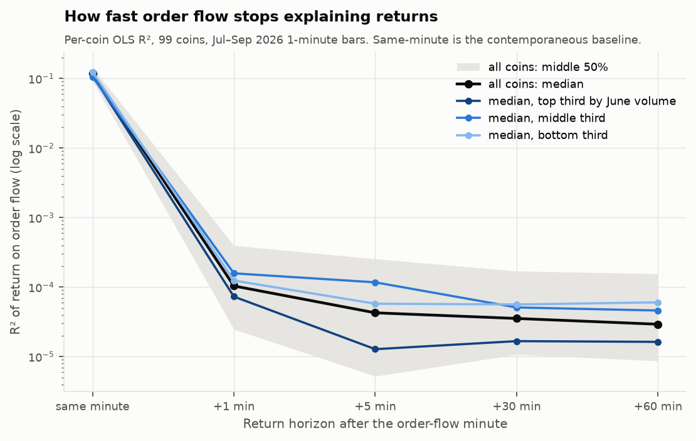
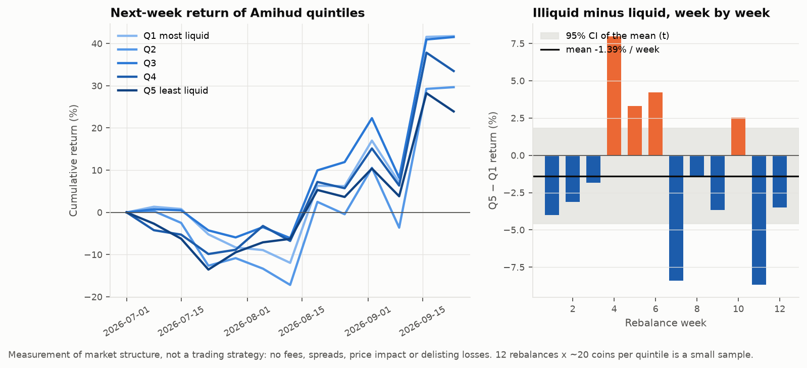
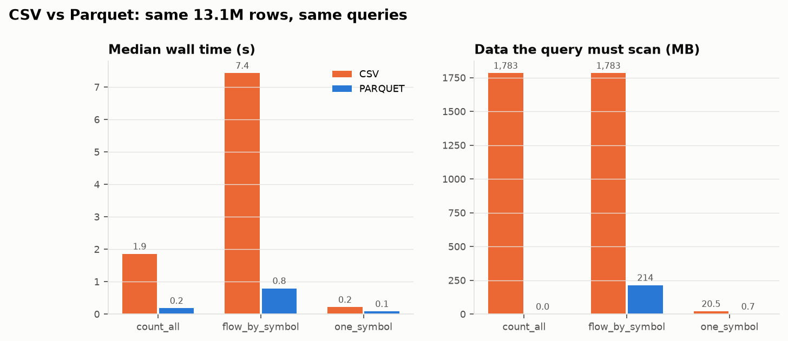
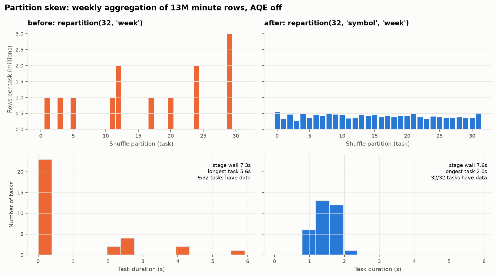
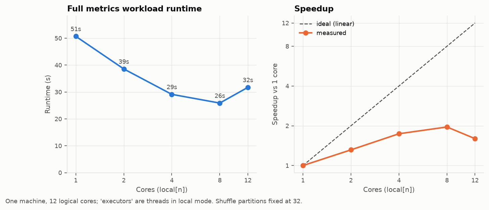

# Crypto Market Microstructure

PySpark analysis of 13.1M Binance one-minute bars across 99 cryptocurrencies (July to September 2026). It asks two questions:

1. **Signal decay:** how long does signed order flow keep predicting returns?
2. **Illiquidity premium:** do less liquid coins earn higher next-week returns?

> This measures market structure. It is not a trading strategy: no fees, spreads, price impact or delisting losses are modelled, and none of the returns shown are achievable.

## Results

| | Finding |
|---|---|
| Signal decay | Median per-coin R² of return on order flow falls from **0.12** in the same minute to **0.0001** one minute ahead. About 70% of coins show slight reversal after that. |
| Illiquidity premium | Least minus most liquid quintile: **−1.39% per week**, 95% CI −4.6% to +1.8% (t = −0.96). No significant premium over 12 weekly rebalances. |
| CSV vs Parquet | Per-symbol aggregate **7.4 s → 0.8 s** (9×); 1,783 MB scanned → 214 MB. |
| Partition skew | Repartitioning by `(symbol, week)` instead of `week`: longest task **5.5 s → 1.2 s**, 9 → 32 of 32 partitions used. |
| Validation | Spark output matches an independent pandas implementation with **zero difference** on every minute-level metric. |







## Data

Binance public archive, spot 1-minute klines: [data.binance.vision](https://data.binance.vision/?prefix=data/spot/monthly/klines/).

The universe is the 100 largest USDT pairs by **June 2026** volume, chosen before the study period so that coins delisted later stay in the sample (no survivorship bias). The archive listing includes delisted symbols. Excluded: leveraged tokens, stablecoins and fiat pairs, tokenized equities, and pairs whose June closes stayed within 1% of their mean. `data/meta/candidates.csv` records the reason for every exclusion.

## Metrics

| Metric | Formula |
|---|---|
| Return | `close / prev_close - 1` |
| Order flow | `2 * taker_buy_base / volume - 1` (range −1 to +1) |
| Amihud illiquidity | `abs(return) / quote_volume` |
| Forward return | `close[t+h] / close[t] - 1`, h = 1, 5, 30, 60 minutes |

Timestamps are microseconds. Every lag and lead is computed over `Window.partitionBy("symbol").orderBy("ts_us")` and accepted only when the neighbouring row is exactly the expected number of minutes away. Zero-volume minutes (13.5% of rows) leave order flow and Amihud empty.

## Pipeline

| Script | What it does |
|---|---|
| `ingest.py universe` | Lists every symbol in the archive, applies exclusions, ranks on June 2026 volume |
| `ingest.py download` | Downloads 300 monthly files in parallel, verifies SHA-256 checksums, writes a manifest |
| `pandas_reference.py` | Plain pandas version of every metric for three coins, used as ground truth |
| `ingest.py parquet` | Spark: CSV → Parquet partitioned by symbol, duplicate minutes dropped |
| `benchmark.py` | CSV vs Parquet read benchmark |
| `metrics.py` | Spark window functions for per-minute and weekly metrics; validates against the pandas reference |
| `analysis.py` | Signal-decay regressions and weekly Amihud quintile portfolios |
| `skew_scaling.py` | Partition-skew experiment (AQE off) and runtime across 1–12 cores |
| `run_all.py` | Runs everything after the download |

Outputs are in `results/` (tables), `results/figures/` (charts) and `results/plans/` (Spark physical plans).

## Running it

Requires Java 17 and Python 3.11+. On Windows, Spark also needs `winutils.exe` and `hadoop.dll` with `HADOOP_HOME` set.

```bash
pip install -r requirements.txt
python ingest.py universe     # ~30 s
python ingest.py download     # ~2 min, ~0.4 GB
python run_all.py             # ~15 min
```

## Limitations

- Kline order flow is a proxy: it gives the net direction of aggressive trading, not imbalance against order-book depth.
- One-minute bars cannot resolve anything faster than a minute.
- 12 weekly rebalances of about 20 coins per quintile is a small sample for a premium test.
- Runs in Spark local mode on one machine (6 physical cores); executors are threads.

## References

- Amihud, Y. (2002). Illiquidity and stock returns: cross-section and time-series effects. *Journal of Financial Markets*, 5(1), 31–56.
- Cont, R., Kukanov, A. and Stoikov, S. (2014). The price impact of order book events. *Journal of Financial Econometrics*, 12(1), 47–88.
